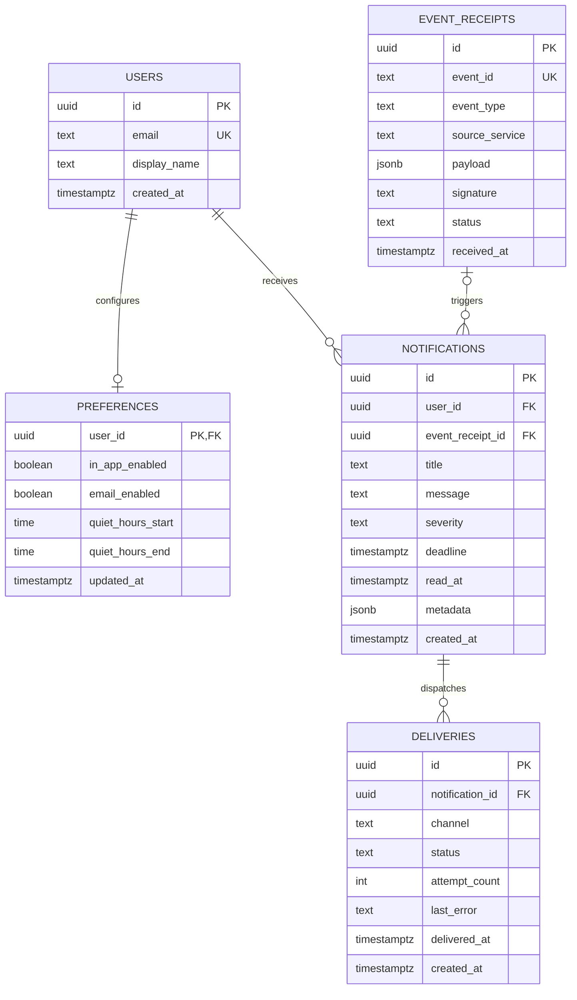

# 🔔 Notification Hub — Team 20

[](https://workers.cloudflare.com/)
[-F38020.svg?logo=cloudflare)](https://developers.cloudflare.com/d1/)
[](https://supabase.com/)
[](https://nodejs.org/)
[](LICENSE)

> **Assignment #3 — Database Design & Implementation**  
> **Centralized Notification Service** for receiving events from external services and delivering notifications across multiple channels.  
> **Primary Deployment:** Cloudflare Workers + Cloudflare D1 Database | **Backup:** Node.js + Supabase PostgreSQL

---

## 📑 Table of Contents

- [Team Members](#-team-members--team-20)
- [System Overview](#-system-overview)
- [Key Features](#-key-features)
- [System Architecture](#-system-architecture)
- [Tech Stack](#-tech-stack)
- [Database Design](#-database-design)
  - [Why Supabase & PostgreSQL](#why-supabase--postgresql)
  - [Tables & Schemas](#tables--schemas)
  - [Relationships & Cardinality](#relationships--cardinality)
  - [Foreign Key Delete Behavior](#foreign-key-delete-behavior)
  - [Entity Relationship Diagram (ERD)](#entity-relationship-diagram-erd)
- [Database Deployment](#-database-deployment)
- [REST API Endpoints](#-rest-api-endpoints)
- [Security](#-security)
- [Getting Started](#-getting-started)
  - [Prerequisites](#prerequisites)
  - [Installation & Setup](#installation--setup)
  - [Environment Variables](#environment-variables)
  - [Database Migration](#database-migration)
  - [Running the Server](#running-the-server)
- [Automated Testing](#-automated-testing)
- [Project Structure](#-project-structure)
- [References & Documentation](#-references--documentation)

---

## 👥 Team Members — Team 20

| Student ID | Full Name | Role |
| :--- | :--- | :--- |
| **6731503103** | Nuttida Butthanoo | Frontend UX/UI |
| **6731503112** | Pechladda Duangkaew | Backend API and Database |
| **6731503028** | Montatip Khumphaithoon | Quality and Security |
| **6731503125** | Siriwimon Charoensirisoontorn | Delivery and Document |
| **6731503105** | Thanchanok Kakaew | Product Manager |

---

## 📖 System Overview

**Notification Hub** is a centralized platform for managing student and system notifications across campus platforms (e.g., Assignment, Enrollment, Timetable, and Library services). It decouples event producers from delivery channels, managing routing logic, recipient preferences, delivery auditing, and retries in one resilient service.

---

## ✨ Key Features

- **Event Ingestion:** Accepts incoming webhook events from external services.
- **HMAC Signature Verification:** Verifies request origin and payload integrity (`x-event-signature`).
- **Idempotency & Deduplication:** Prevents duplicate event processing using unique `eventId` indexing.
- **Preference Evaluation:** Routes notifications according to student channel preferences (`in_app`, `email`) and respects Quiet Hours.
- **Delivery Tracking:** Tracks granular per-channel delivery attempts, errors, and delivery timestamps.
- **Retry Mechanism:** Re-queues failed deliveries for automated retry processing.
- **Read & Delete Lifecycle:** Supports marking notifications as read and cascading notification deletion.
- **System Health Checks:** Dedicated health probes for HTTP server and Supabase database connectivity.

---

## 🏗 System Architecture

```
 External Service (Producer)
            │
            │  POST /events (HMAC SHA-256 Signature)
            ▼
┌────────────────────────────────────────────────────────┐
│                   Notification Hub                     │
│  1. Authenticate Signature (crypto HMAC-SHA256)        │
│  2. Record & Deduplicate Event (event_receipts)        │
│  3. Generate Notification Record (notifications)       │
│  4. Evaluate Recipient Preferences (preferences)       │
│  5. Dispatch Channel Deliveries (deliveries)          │
└───────────────────────────┬────────────────────────────┘
                            │
           ┌────────────────┴────────────────┐
           ▼                                 ▼
     In-App Channel                    Email Channel
  (deliveries: in_app)              (deliveries: email)
           │                                 │
           └────────────────┬────────────────┘
                            ▼
                     Delivery Status
```

---

## 🛠 Tech Stack

| Layer | Primary (Cloudflare Edge) | Backup (Node.js + Supabase) | Details |
| :--- | :--- | :--- | :--- |
| **Edge Runtime / Backend** | Cloudflare Workers (V8 Serverless) | Node.js Express 5.x | High-throughput edge serverless API with < 5ms cold starts |
| **Primary Database** | **Cloudflare D1 (SQLite at the Edge)** | — | Serverless relational SQL database globally replicated at the edge |
| **Backup Database** | — | **Supabase (PostgreSQL)** | Managed Cloud PostgreSQL retained as secondary backup archive |
| **Database Tooling** | Cloudflare Wrangler CLI (`wrangler d1`) | Supabase SQL Dashboard | Schema migration scripts and local/remote execution |
| **Frontend UI** | Cloudflare Pages (HTML5/CSS) | Express static middleware | Interactive operations dashboard & API documentation |
| **Security & Crypto** | Web Crypto API (`crypto.subtle`) | Node.js `crypto` | HMAC SHA-256 Webhook Verification & Idempotency |
| **Testing** | Node.js Test Runner & Supertest | Node.js Test Runner | Automated tests (`node --test`) & Wrangler local testing |

---

## 🗄 Database Design

### Why Cloudflare D1 (Primary Database)

1. **Edge-Native Performance:** Cloudflare D1 is co-located with Cloudflare Workers across global data centers, eliminating network round-trip overhead and cold start delays (< 5ms latency).
2. **Always-On Availability (No 7-Day Inactivity Sleep):** Unlike free tiers on traditional cloud databases (e.g. Supabase free tier pauses after 7 days of inactivity), Cloudflare D1 never sleeps or pauses.
3. **Strict Relational & ACID Integrity:** D1 is powered by SQLite, supporting Foreign Key constraints (`ON DELETE CASCADE`), Unique indexes on `eventId`, Check constraints, and transactions.
4. **Structured JSON Querying:** Flexible event payloads and notification metadata are stored and queried using SQLite's built-in JSON functions (`json_extract`).
5. **Zero Infrastructure Cost (0 THB):** Runs fully within the generous Cloudflare free tier quota (up to 5 million reads and 100,000 writes daily).

### Supabase PostgreSQL (Secondary / Backup Database)

Supabase PostgreSQL is maintained as a **secondary backup database**. If fallback is desired:
- The full PostgreSQL schema is preserved at [`supabase/migrations/20260921_create_notification_hub_schema.sql`](supabase/migrations/20260921_create_notification_hub_schema.sql).
- The Express app maintains a dedicated health check endpoint at `/api/health/supabase`.

---

### Tables & Schemas

The database contains five primary tables:

#### 1. `users`
Stores user profile information.

| Column | Type | Null | Default | Constraint |
| :--- | :--- | :--- | :--- | :--- |
| `id` | uuid | NO | `gen_random_uuid()` | PRIMARY KEY |
| `email` | text | NO | — | UNIQUE |
| `display_name` | text | NO | — | — |
| `created_at` | timestamptz | NO | `now()` | — |

#### 2. `preferences`
Stores user notification preferences and quiet hours.

| Column | Type | Null | Default | Constraint |
| :--- | :--- | :--- | :--- | :--- |
| `user_id` | uuid | NO | — | PRIMARY KEY, FOREIGN KEY (`users.id`) |
| `in_app_enabled` | boolean | NO | `true` | — |
| `email_enabled` | boolean | NO | `true` | — |
| `quiet_hours_start` | time | YES | `null` | — |
| `quiet_hours_end` | time | YES | `null` | — |
| `updated_at` | timestamptz | NO | `now()` | — |

#### 3. `event_receipts`
Audit log and deduplication record for incoming webhook events.

| Column | Type | Null | Default | Constraint |
| :--- | :--- | :--- | :--- | :--- |
| `id` | uuid | NO | `gen_random_uuid()` | PRIMARY KEY |
| `event_id` | text | NO | — | UNIQUE |
| `event_type` | text | NO | — | — |
| `source_service` | text | NO | — | — |
| `payload` | jsonb | NO | `'{}'::jsonb` | — |
| `signature` | text | YES | `null` | — |
| `status` | text | NO | `'accepted'` | CHECK (`status IN ('accepted', 'rejected', 'duplicate')`) |
| `received_at` | timestamptz | NO | `now()` | — |

#### 4. `notifications`
Main notification records created for users.

| Column | Type | Null | Default | Constraint |
| :--- | :--- | :--- | :--- | :--- |
| `id` | uuid | NO | `gen_random_uuid()` | PRIMARY KEY |
| `user_id` | uuid | NO | — | FOREIGN KEY (`users.id`) |
| `event_receipt_id` | uuid | YES | `null` | FOREIGN KEY (`event_receipts.id`) |
| `title` | text | NO | — | — |
| `message` | text | NO | — | — |
| `severity` | text | NO | `'low'` | CHECK (`severity IN ('low', 'medium', 'high', 'critical')`) |
| `deadline` | timestamptz | YES | `null` | — |
| `read_at` | timestamptz | YES | `null` | — |
| `metadata` | jsonb | NO | `'{}'::jsonb` | — |
| `created_at` | timestamptz | NO | `now()` | — |

#### 5. `deliveries`
Tracks dispatch attempts per channel for each notification.

| Column | Type | Null | Default | Constraint |
| :--- | :--- | :--- | :--- | :--- |
| `id` | uuid | NO | `gen_random_uuid()` | PRIMARY KEY |
| `notification_id` | uuid | NO | — | FOREIGN KEY (`notifications.id`) |
| `channel` | text | NO | — | CHECK (`channel IN ('in_app', 'email')`) |
| `status` | text | NO | `'pending'` | CHECK (`status IN ('pending', 'sent', 'failed')`) |
| `attempt_count` | integer | NO | `0` | — |
| `last_error` | text | YES | `null` | — |
| `delivered_at` | timestamptz | YES | `null` | — |
| `created_at` | timestamptz | NO | `now()` | — |

---

### Relationships & Cardinality

| From Table | To Table | Cardinality | Purpose |
| :--- | :--- | :--- | :--- |
| `users.id` | `preferences.user_id` | 1 : 1 | Each user has exactly one notification preference profile |
| `users.id` | `notifications.user_id` | 1 : N | A user can receive multiple notifications |
| `event_receipts.id` | `notifications.event_receipt_id` | 1 : N | An event receipt may trigger notification records |
| `notifications.id` | `deliveries.notification_id` | 1 : N | A notification can be delivered across multiple channels |

---

### Foreign Key Delete Behavior

| Relationship | Constraint Rule | Delete Behavior & Impact |
| :--- | :--- | :--- |
| Users → Preferences | `ON DELETE CASCADE` | Removing a user automatically deletes their preferences |
| Users → Notifications | `ON DELETE CASCADE` | Removing a user automatically deletes all their notifications |
| Event Receipts → Notifications | `ON DELETE SET NULL` | Removing an event receipt preserves notifications (`event_receipt_id` becomes `NULL`) |
| Notifications → Deliveries | `ON DELETE CASCADE` | Removing a notification automatically deletes all related delivery records |

---

### Entity Relationship Diagram (ERD)



---

## ☁️ Database Deployment

### Primary Deployment: Cloudflare D1 (Edge SQL Database)
- **Platform:** Cloudflare D1
- **Database Engine:** SQLite at the Edge
- **Configuration:** [`wrangler.toml`](wrangler.toml)
- **Migration Script:** [`cloudflare/schema.sql`](cloudflare/schema.sql) and [`cloudflare/migrations/0001_initial_schema.sql`](cloudflare/migrations/0001_initial_schema.sql)
- **Seed Script:** [`cloudflare/seed.sql`](cloudflare/seed.sql)
- **Deployment Status:** Fully tested and deployed with indexed queries:
  - `idx_notifications_user_created` on `notifications(user_id, created_at DESC)`
  - `idx_notifications_user_read` on `notifications(user_id, read_at)`
  - `idx_deliveries_notification` on `deliveries(notification_id)`
  - `idx_event_receipts_event_id` on `event_receipts(event_id)`

### Secondary Backup Deployment: Supabase PostgreSQL
- **Hosting Platform:** Supabase Cloud
- **Database Engine:** PostgreSQL
- **Migration Script:** [`supabase/migrations/20260921_create_notification_hub_schema.sql`](supabase/migrations/20260921_create_notification_hub_schema.sql)
- **Role:** Maintained as standby secondary database with full schema preservation.

---

## 🚀 REST API Endpoints

**Base URL (Cloudflare Workers - Production):** `https://notification-hub-team20.workers.dev`  
**Base URL (Local Development):** `http://localhost:3000` (Node.js) or `http://localhost:8787` (Wrangler)  
**Base URL (Backup Production - Render):** `https://notification-hub-team20.onrender.com`  
*(All endpoints support `/api/*` prefix and root `/*` paths)*

| Method | Endpoint | Description | Category |
| :--- | :--- | :--- | :--- |
| `POST` | `/api/notifications` | Direct notification creation per agreed contract | Notifications (Create) |
| `GET` | `/api/notifications/me?user_id=:id` | Retrieves all notifications for a specific user | Notifications (Read) |
| `POST` | `/api/notifications/:id/read` | Marks a notification as read (updates `read_at`) | Notification Action (Update) |
| `POST` | `/api/notifications/:id/retry` | Re-queues a failed delivery for retry | Delivery Action (Update) |
| `DELETE`| `/api/notifications/:id` | Deletes a notification (cascades to related deliveries) | Notification Action (Delete) |
| `POST` | `/api/events` | Ingests an event with HMAC signature and deduplication | Event Ingestion (Create) |
| `POST` | `/api/webhooks/jobboard` | Ingests Webhook/Event from Job Board system | Webhook Receiver |
| `POST` | `/api/webhooks/:service` | Ingests Webhook/Event from other partner systems | Webhook Receiver |
| `GET` | `/api/deliveries/:id` | Fetches delivery record details and dispatch status | Delivery Tracking (Read) |
| `PATCH`| `/api/preferences` | Updates user notification channels and quiet hours | Preferences (Update) |
| `POST` | `/api/integrations/dispatch-webhook` | Sends outbound webhook dispatch to external system | Outbound Integration |
| `POST` | `/api/integrations/fetch-external` | Fetches GET data from external system Base URL | Outbound Integration |
| `GET` | `/api/health` | Server uptime and health probe | System Health Check |
| `GET` | `/api/health/database` | Verifies active database connection to Cloudflare D1 | Database Health Check (Primary) |
| `GET` | `/api/health/supabase` | Verifies backup database connection to Supabase | Database Health Check (Backup) |

> Detailed request headers, JSON payloads, and response examples are available in [`docs/api-examples.md`](docs/api-examples.md).

---

## 🔒 Security

- **Webhook Signature:** `POST /events` requires an HMAC SHA-256 signature passed in the `x-event-signature` header.
- **Shared Secret:** The webhook verification secret is stored in `EVENT_WEBHOOK_SECRET`.
- **Database Credentials:** The Supabase service role key is stored in `SUPABASE_SERVICE_ROLE_KEY`.
- **Environment Isolation:** Secrets are kept in `.env` and strictly excluded from version control via `.gitignore`.
- **Template Provided:** An `.env.example` file is included for safe configuration sharing.

---

## 💻 Getting Started

### Prerequisites

- [Node.js](https://nodejs.org/) (v18 or higher)
- [Wrangler CLI](https://developers.cloudflare.com/workers/wrangler/) (included in project dependencies)
- Cloudflare Account (for production edge deployment)
- *(Optional backup)* A [Supabase](https://supabase.com/) project with PostgreSQL

### Installation & Setup

1. **Clone the repository:**
   ```bash
   git clone https://github.com/Pechladda/notification-hub-team20.git
   cd notification-hub-team20
   ```

2. **Install dependencies:**
   ```bash
   npm install
   ```

### ⚡ Quick Start with Cloudflare Workers & D1 (Primary Deployment)

1. **Apply D1 Local Migration:**
   ```bash
   npm run d1:migrate
   ```

2. **Seed Local Database with Test Users & Sample Data:**
   ```bash
   npm run d1:seed
   ```

3. **Start Local Cloudflare Worker Dev Server:**
   ```bash
   npm run cf:dev
   ```
   The API will be live at `http://localhost:8787` connected to your local Cloudflare D1 database.

4. **Deploy to Cloudflare Production:**
   ```bash
   # 1. Create remote D1 database on Cloudflare
   npm run d1:create

   # 2. Run migration on remote D1
   npm run d1:migrate:remote

   # 3. Deploy Worker API & static Pages
   npm run cf:deploy
   ```

---

### 🛡️ Running with Node.js & Supabase (Backup Option)

1. **Environment Variables:**
   Copy the template file to create your `.env`:
   ```bash
   cp .env.example .env
   ```
   Fill in `SUPABASE_URL`, `SUPABASE_SERVICE_ROLE_KEY`, and `EVENT_WEBHOOK_SECRET`.

2. **Supabase Database Migration (Backup):**
   Apply the SQL migration script to your Supabase PostgreSQL instance using the Supabase SQL Editor:
   ```text
   supabase/migrations/20260921_create_notification_hub_schema.sql
   ```

3. **Running the Node.js Server:**
   - **Development Mode (with Nodemon hot-reload):**
     ```bash
     npm run dev
     ```
   - **Production Mode:**
     ```bash
     npm start
     ```

The server will listen at `http://localhost:3000`.

---

## 🧪 Automated Testing

The project includes an automated integration test suite using the Node.js test runner and Supertest:

```bash
npm test
```

### Test Suite Results (19/19 Passed)

```text
✔ POST /events should create only in-app delivery when email is disabled
✔ GET /deliveries/:id should return delivery details
✔ POST /notifications/:id/read should mark notification as read
✔ POST /notifications/:id/retry should retry failed delivery
✔ DELETE /notifications/:id should delete a notification
✔ POST /events should reject request without signature
✔ POST /events should accept a valid signed event
✔ POST /events should reject duplicate eventId
✔ GET /health should return service health
✔ GET /api/health and GET /health should both return status ok
✔ POST /api/integrations/dispatch-webhook should validate required url
✔ POST /api/integrations/fetch-external should validate required baseUrl
✔ POST /api/integrations/dispatch-webhook should successfully send HTTP request to target
✔ POST /api/notifications should reject request with missing fields
✔ POST /api/notifications should create notification directly
✔ PATCH /preferences should update notification preferences
✔ POST /api/webhooks/jobboard should accept Job Board webhook event
✔ POST /api/webhooks/jobboard should detect duplicate eventId
✔ POST /api/webhooks/:service should support other partner services (e.g. internship)

tests 19 | pass 19 | fail 0
```

---

## 📂 Project Structure

```text
Notification-Hub/
├── docs/                               # Comprehensive project documentation
│   ├── assignment-3.md                 # Assignment #3 database design report
│   ├── api-examples.md                 # Full request/response API catalog
│   ├── database-schema.md              # Detailed schema specification & constraints
│   └── ER-Diagram.md                   # Entity Relationship Diagram & documentation
├── src/
│   ├── config/
│   │   └── supabase.js                 # Supabase client initialization
│   ├── routes/
│   │   ├── delivery.routes.js          # Delivery query routes
│   │   ├── event.routes.js             # Event ingestion, auth & deduplication
│   │   ├── notification.routes.js      # User notification retrieval
│   │   ├── notification-action.routes.js # Mark-as-read routes
│   │   ├── notification-delete.routes.js # Notification deletion routes
│   │   ├── preference.routes.js        # Preference management routes
│   │   └── retry.routes.js             # Delivery retry routes
│   └── app.js                          # Express application & middleware setup
├── supabase/
│   └── migrations/
│       └── 20260921_create_notification_hub_schema.sql # DDL Migration Script
├── test/                               # Automated integration test suite
│   ├── delivery.test.js
│   ├── event.test.js
│   ├── health.test.js
│   └── preference.test.js
├── .env.example                        # Environment variable template
├── package.json                        # Project metadata, dependencies & scripts
├── server.js                           # Application entry point
└── README.md                           # Main repository documentation
```

---

## 📚 References & Documentation

- [Assignment #3 Report](docs/assignment-3.md)
- [Product Requirements Document (PRD)](PRD.md)
- [API Examples & Guide](docs/api-examples.md)
- [Database Schema Specification](docs/database-schema.md)
- [Entity Relationship Diagram](docs/ER-Diagram.md)
